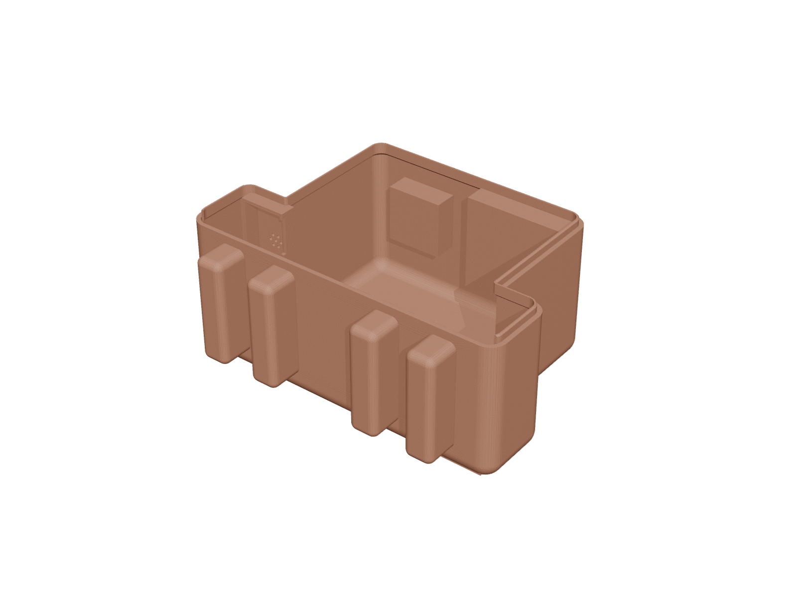
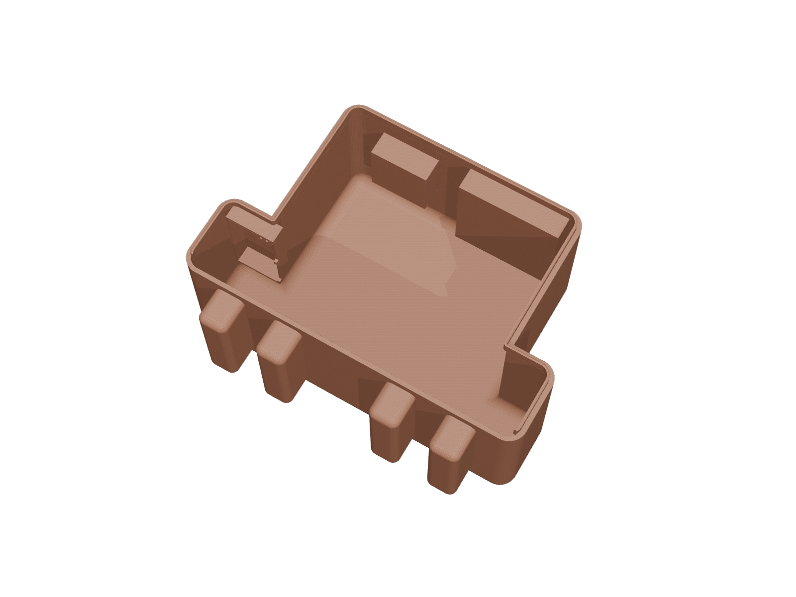
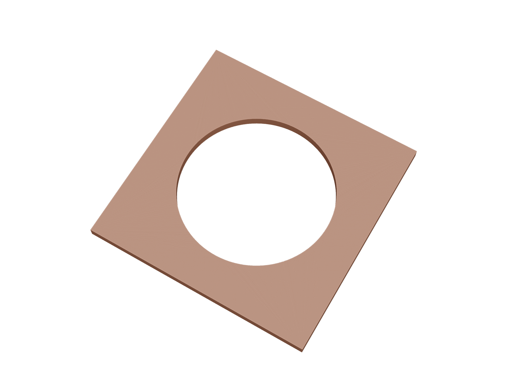
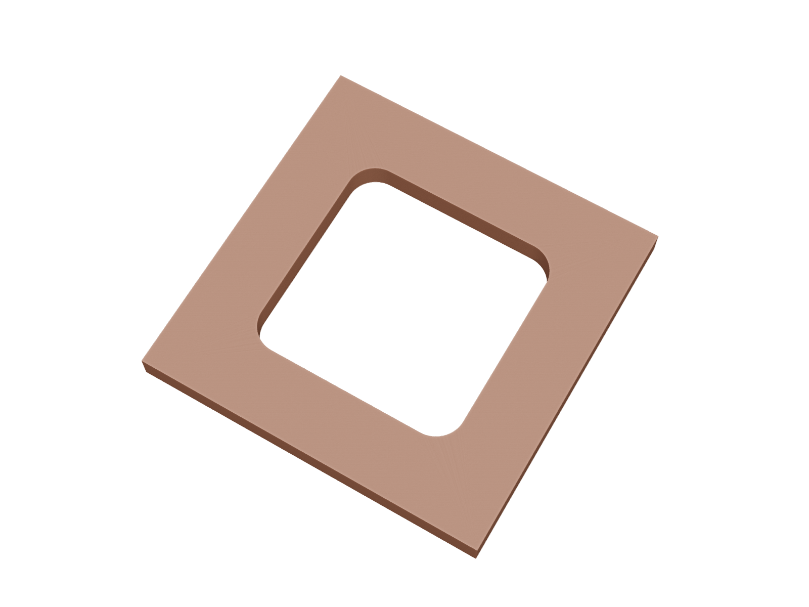

# Clawd bot

A desk robot that shows what [Claude Code](https://claude.com/claude-code) is doing,
and that you can talk to.

- **Eyes:** two small screens, mounted portrait. They animate a mood for each
  Claude Code event: thinking, running a tool (with the tool name and command
  as captions), waiting for your permission, or done.
- **Voice:** hold the button and speak. Your words become a prompt in a Claude Code
  session, and the reply is spoken back through the speaker.
- **Status light:** a 3×3 LED grid.
- **Knob:** turn for volume; press to cancel.

Open `docs/index.html` for a live preview of every mood. That page is also the project
website (see below).

## Hardware

Built on an [Atech](https://atech.dev) 14-port board (ESP32-S3), using all 12 slots:

| Module | Instance | Ports |
|---|---|---|
| ST7735 screen ×2 | `eye_l`, `eye_r` | 1+2, 5+6 |
| I2S microphone | `mic` | 3+4 |
| Rotary encoder | `knob` | 9+10 |
| I2S speaker | `spk` | 13+14 |
| Button | `btn` | 7 |
| NeoPixel 3×3 | `led` | 11 |

Case: `case/Clawd_Case_v2.stl`. Print it as one piece, as it comes, with no rotation. See
`case/PRINT_ME.md` and `case/CAD_NOTES.md`. The FreeCAD source is
`case/ClaudeDeskCompanion.FCStd`.

### Clawd body (new case)

A newer body shell, printed and in use. Print each file as it comes, flat on the bed.
All sizes are in millimetres.

| File | Part | Size |
|---|---|---|
| `case/clawd_body.stl` | Body shell (open side up) | 160 × 120 × 70.5 |
| `case/clawd_cover_knob.stl` | Trim plate around the knob | 44.6 × 44.6 × 2 |
| `case/clawd_cover_button.stl` | Trim plate around the button | 24.6 × 24.6 × 2 |

Reference print of the body: Bambu Lab H2S, textured PEI plate, PETG, 260.7 g,
about 7 h 35 min.

| Body | Inside | Knob cover | Button cover |
|---|---|---|---|
|  |  |  |  |

## Get started

```bash
pip install -r bridge/requirements.txt             # atech, openai, pyserial

atech validate firmware
atech upload firmware        # at boot each eye shows an UP arrow: check both point up

python bridge/clawd_bridge.py install-hooks        # adds hooks to ~/.claude/settings.json (backed up)
python bridge/clawd_bridge.py demo                 # cycles every mood: test screens, LED, chimes

export OPENAI_API_KEY=...                          # needed for voice only
python bridge/clawd_bridge.py say "hello"          # speaker test
python bridge/clawd_bridge.py run --workdir ~/code/my-project
```

If an eye's arrow points down, change `EYE_L_ROT` / `EYE_R_ROT` in
`firmware/project.yaml` from `1` to `3`. To try it live without reflashing, run
`atech send orient_l 3`.

Remove the hooks with `python bridge/clawd_bridge.py uninstall-hooks`.

To keep the bridge running in the background on Linux, use the example systemd
user service. Edit the paths in it first; put `OPENAI_API_KEY=...` in
`~/.config/clawd_bot/env`.

```bash
cp bridge/clawd-bridge.service ~/.config/systemd/user/
systemctl --user enable --now clawd-bridge
journalctl --user -u clawd-bridge -f              # logs
```

## How it works

```
Claude Code hook ──curl──▶ bridge (127.0.0.1:8765) ──USB serial──▶ eyes + LED
button held ──▶ mic stream ──▶ OpenAI transcribe ──▶ claude -p --resume ──▶ OpenAI TTS ──▶ speaker
```

- `bridge/clawd_bridge.py` is a single process. It owns the serial port, receives
  hooks, and runs voice turns.
- Hooks are global, so every Claude Code session on the machine drives the eyes.
  If the bridge isn't running, a hook exits in milliseconds and never blocks Claude.
- Each `--workdir` gets one dedicated Claude Code session for voice. Its id is
  stored in `~/.config/clawd_bot/state.json`.
- Voice prompts run with `--permission-mode acceptEdits` by default. In `-p` mode,
  tools that need approval are denied. Change this deliberately.

Wire protocol: one JSON object per line.

```
host → board   {"action":"mood","value":"idle|thinking|tool|waiting|done|listening|speaking|error|sleep"}
               {"action":"label","value":"Bash"}       {"action":"detail","value":"npm test"}
               {"action":"spk_play_pcm","value":"<base64 16 kHz s16le mono>"}
board → host   btn 1/0, knob_btn, volume 0-100, mic_audio <base64>, ptt "end"
```

## Firmware

`firmware/project.yaml` is an [atech](https://pypi.org/project/atech/) project.
`atech build firmware` generates a PlatformIO project and compiles it.

`firmware/modules/` holds patched copies of two atech SDK drivers. They override
the SDK's own copies:

- `microphone`: adds `startStream()` / `readStream()`, a ring buffer for
  continuous capture (the stock driver records at most 3 s).
- `st7735_tft`: adds `setCanvasRotation()` for portrait-mounted panels.

## Status

| | |
|---|---|
| Builds | Firmware compiles with `atech` 1.0.0a11 from PyPI. The bridge is tested against a mock board. |
| Proven on hardware | The two eye screens on ports 1+2 and 5+6. |
| Not yet proven | Mic, knob and speaker port pairs; audio over USB in both directions; which rotation is "up" for portrait eyes. |
| Case | It only has openings for the eyes, so the button, knob and LED need holes. The speaker doesn't fit inside and hangs on a cable. |

## Website

`docs/` is a static site with no build step. On GitHub, go to **Settings → Pages →
Deploy from branch → `main` / `docs`**.

## License

MIT, see `LICENSE`. The drivers in `firmware/modules/` are derived from the
MIT-licensed [atech Python SDK](https://pypi.org/project/atech/). The module
renders in `docs/img/` come from the atech asset library.
